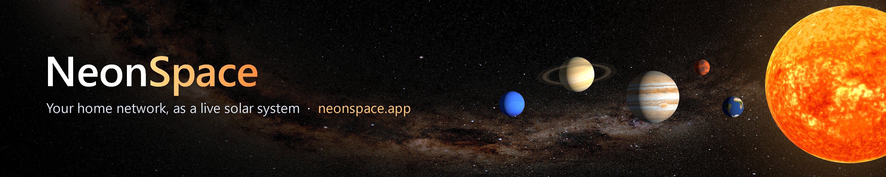

### Hi, I'm Degen 👋

I built **[NeonSpace](https://neonspace.app)**, a home network dashboard that shows every device in your house as a planet in a live solar system. It's made for the whole family: calm enough for anyone to read at a glance, with a kids mode, plain-English alerts and an optional AI helper called Juno.

- 🪐 **NeonSpace:** [neonspace.app](https://neonspace.app) · [feedback and bug reports](https://github.com/Hemiboy98/neonspace-app/issues)
- 📫 **Contact:** support@neonspace.app

Banner: planet maps by Solar System Scope (CC BY 4.0), based on NASA imagery. Stars: NASA/Goddard SVS, Gaia, ESA.
